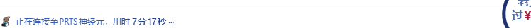

# dsh-plugin-prts-neuron

把 DSH WebUI 对话里的运行状态行换成 PRTS 神经元连接态：



- 左侧图标：原来的鲸鱼尾 → `https://i0.hdslb.com/bfs/new_dyn/a5a0a0adb386867b3f5db5713576f9f5107716290.gif`
- 文案：`深度求索中，用时 3秒 ···` → `正在连接至PRTS神经元，用时 3秒 ···`

## 原理

ui-chat 的运行状态行自带 `data-chat-running` 属性，内部是「鲸鱼尾图标 + TextShimmer 文案」，并且**每秒**随计时器重渲染一次。插件不改 ui-chat 的源码，而是走 DOM 缝：

| 目标 | 做法 |
|------|------|
| 图标 | 行内 icon 盒子前插入一张 ``，原 icon 盒子 `display:none`；图片加载失败（离线／防盗链）时移除图片并恢复原图标 |
| 文案 | 监听文档变更，把行内文本节点、无障碍播报行、以及 TextShimmer 装饰层读取的 `data-shimmer-text` 属性里的「深度求索中」替换为「正在连接至PRTS神经元」 |

React 每次 tick 会把文案写回原值，MutationObserver 在同一个微任务批次里改回去（浏览器绘制前完成，不闪烁）。两侧写入都幂等，所以观察者每轮渲染后即收敛，不会自激循环。

匹配用的是 ui-chat 的作者级标记：`data-chat-running`、`data-shimmer-text`，以及鲸鱼 SVG 的父元素（icon 盒子）。**不匹配 CSS Module 的哈希类名**，因此对上游样式重构不敏感。

`referrerpolicy="no-referrer"` 是必需的：实测 B 站图床带 referrer 请求该图返回失败，去掉 referrer 才加载成功（1000×1000 动图，缩到 16px 显示）。

## 开发

```powershell
pnpm install
pnpm typecheck
pnpm test
pnpm build          # 产出 lib/index.js + lib/client.js + lib/types/
```

改文案或图标 URL：只改 [`src/client/copy.ts`](src/client/copy.ts) 一处，然后 `pnpm build`。

## 运行（安装到 profile）

```powershell
dsh plugin --profile web add "link:D:/Projects/deepseek-harness/dsh-plugin-prts-neuron"
# 或远端引用：dsh plugin --profile web add "github:huanlinoto/dsh-plugin-prts-neuron"
```

`dsh plugin add` 已把包登记进 profile 的 `dsh.profile.bundles`。**实测无需重启 `dsh web`**：host 在页面加载时重组 client roster，浏览器硬刷新（Ctrl+Shift+R）即可，`window.__DSH_BOOT__.entries` 里会出现 `@huanlin/dsh-plugin-prts-neuron`。改源码后重建 `lib/` 再刷新页面即可（`link:` 引用无需重装）。

## 检查

```powershell
pnpm test           # jsdom 单测：图标替换、三处文案替换、幂等、挂载后自愈、dispose 后停手、图片失败回退
pnpm typecheck
```

单测直接喂 ui-chat 的标记结构（fixture 见 [`tests/running-status.spec.ts`](tests/running-status.spec.ts)），不依赖真实 GUI。真实 GUI 的复验见 `docs/running-row.png`。

## 已知限制

- **文案与图标是构建期常量**：client 半边拿不到 Cordis 行配置（`window.__DSH_BOOT__` 的 boot 行只有 `id`/`inject`/`external`/`immediately`），所以没有配置项。要做成可配置，需要另建 host→browser 通道（settings 命名空间 + HTTP 路由或 Remote 服务），目前按 YAGNI 不做。
- **只替换中文文案**：英文 locale 的 `Deep diving` 不动。要支持英文，在 `copy.ts` 里把替换做成多对即可。
- **依赖 ui-chat 的 DOM 标记**：若上游移除 `data-chat-running`/`data-shimmer-text` 或改变 icon 盒子结构，替换会静默失效（不报错，页面显示原样）。
- **图标是外链**：B 站图床若限制加强或该图下线，行内会回退成原来的鲸鱼尾图标。
